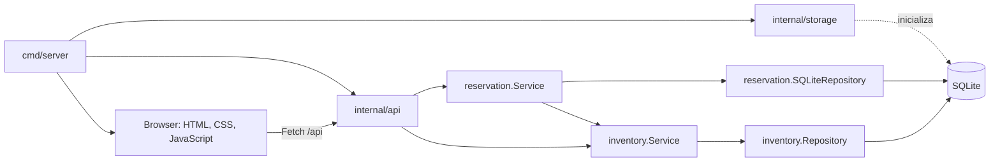
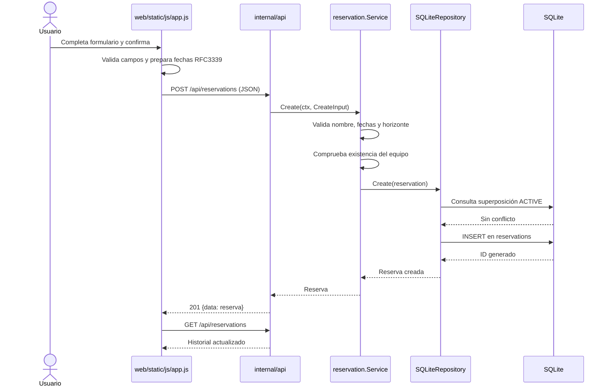

# Flujo interno de la aplicación

Este documento describe el recorrido implementado por el código actual. El alcance del MVP y la forma de ejecutarlo están en [README.md](README.md); las comprobaciones y sus evidencias están en [docs/testing.md](docs/testing.md).

## 1. Visión general

La aplicación es un monolito modular. El navegador sirve la interfaz HTML, CSS y JavaScript desde el mismo servidor Go que expone la API REST. Los handlers convierten HTTP/JSON en llamadas a servicios; los servicios aplican validaciones y reglas de negocio; los repositorios ejecutan consultas SQLite.



| Capa | Responsabilidad en esta implementación |
|---|---|
| `web/` | Renderiza inventario y reservas, recoge entradas, valida campos en el navegador y llama a la API con Fetch. |
| `internal/api/` | Enruta las solicitudes, valida el formato HTTP/JSON y traduce errores a respuestas JSON y códigos HTTP. Recibe interfaces de servicio; no abre SQLite. |
| `internal/reservation/` | Define `Equipment`, `Reservation`, estados y reglas de reserva; consulta disponibilidad y delega la persistencia al repositorio. |
| `internal/inventory/` | Normaliza y valida altas de equipos y proporciona consultas y escritura mediante su repositorio. |
| `internal/storage/` | Abre la base SQLite, crea o adapta el esquema y carga el catálogo inicial. |
| `cmd/server/` | Ensambla dependencias, registra handlers HTTP y sirve la aplicación. |

## 2. Inicialización de la aplicación

El punto de entrada es `cmd/server/main.go`. `main()` llama a `run()` y termina con `log.Fatal` si la inicialización o el servidor devuelve un error.

1. `run()` invoca `storage.Initialize(context.Background())`.
2. `Initialize` delega a `InitializeAt` con la ruta `data/reservations.db`.
3. `InitializeAt` crea el directorio padre si falta, abre el driver `sqlite`, configura el pool con una conexión máxima y una conexión inactiva máxima, hace `Ping` e inicializa esquema e inventario dentro de una transacción.
4. El esquema crea `equipment` y `reservations` si aún no existen. `ensureRequesterColumn` agrega `requester` a bases antiguas que no la tengan. Los cinco equipos iniciales se insertan con `ON CONFLICT (id) DO NOTHING`, sin reemplazar datos existentes.
5. `run()` construye `reservation.SQLiteRepository`, `inventory.Repository`, `inventory.Service`, `reservation.Service` y el handler de `internal/api`. El servicio de reservas recibe el servicio de inventario como su lector de equipos.
6. Se registra un `http.ServeMux`: `/api/` se deriva al handler API; `/static/` se sirve desde `web/static` con `http.FileServer` y `StripPrefix`; `GET /` sirve `web/templates/index.html`; las demás rutas caen en un handler 404.
7. `http.Server` escucha en `127.0.0.1:8080` y define `ReadHeaderTimeout` de 5 s, `ReadTimeout` y `WriteTimeout` de 15 s, e `IdleTimeout` de 60 s. `ListenAndServe` inicia el servidor. Al retornar `run`, se cierra la conexión SQLite con `defer db.Close()`.

La ruta de la base y las rutas de los archivos web son relativas al directorio de ejecución; por eso los comandos del README se ejecutan desde la raíz del repositorio.

## 3. Flujo de creación de una reserva

La interacción está en `web/templates/index.html` y `web/static/js/app.js`; el endpoint es `POST /api/reservations`.

1. El usuario elige el equipo, escribe el nombre del solicitante y elige inicio y finalización.
2. Mientras escribe, el frontend elimina los caracteres que no sean letras o marcas diacríticas Unicode ni espacios, y comunica cuando quitó caracteres. Antes de enviar, valida el nombre. El HTML también declara campos obligatorios y un patrón.
3. Al cambiar el inicio, JavaScript calcula el final sumando una hora en el tiempo local y lo completa en el campo final. Se permite editar ese valor. Si el final automático supera el máximo del navegador, queda inválido y se muestra un mensaje.
4. Al enviar, `createReservation` llama a `reportValidity()` y `selectedInterval()` comprueba que haya equipo e intervalo, que las fechas sean parseables, que ambas fechas no excedan el máximo local y que el inicio preceda al final. Las fechas se convierten a ISO/RFC3339 UTC en la solicitud.
5. `requestJSON` envía JSON a `POST /api/reservations` con `Content-Type: application/json`.
6. `api.handler.ServeHTTP` enruta la solicitud a `createReservation`. `decodeJSON` requiere JSON, rechaza campos desconocidos y valores JSON adicionales, y el handler limita los cuerpos a 1 MiB.
7. `reservation.Service.Create` normaliza el ID del equipo y el nombre, exige ambos, valida que el solicitante contenga letras y espacios permitidos, parsea RFC3339, exige inicio anterior al final y aplica el máximo calculado desde la fecha local del servidor más seis meses calendario. También consulta que exista el equipo.
8. `SQLiteRepository.Create` abre una transacción y consulta si existe una reserva `ACTIVE` superpuesta para ese equipo. Si no hay conflicto, inserta la reserva, asigna el ID generado y confirma la transacción.
9. El handler devuelve HTTP 201 con el objeto de reserva dentro de `{ "data": ... }`. JavaScript muestra el resultado y vuelve a cargar el historial.



Las validaciones del navegador mejoran la interacción, pero el servicio Go vuelve a validar las reglas relevantes. La disponibilidad final no depende exclusivamente del frontend.

## 4. Flujo de cancelación

1. En el historial, JavaScript ofrece el botón de cancelación para reservas con estado `ACTIVE` y solicita confirmación.
2. Envía `PATCH /api/reservations/{id}/cancel` sin cuerpo.
3. El handler convierte el ID de ruta a entero positivo y llama a `reservation.Service.Cancel`.
4. El servicio rechaza un ID inválido y delega al repositorio.
5. `SQLiteRepository.Cancel` actualiza solo la fila cuyo estado actual es `ACTIVE`: establece `CANCELLED` y `canceled_at` con la hora de cancelación. Después lee la fila actualizada. Si no se modificó una fila, diferencia entre reserva inexistente y cancelada previamente.
6. El handler devuelve HTTP 200 con la reserva actualizada. El frontend recarga el historial, que incluye reservas canceladas.

La fila no se elimina. La consulta de superposición filtra exclusivamente por estado `ACTIVE`, de modo que el intervalo de una reserva cancelada deja de bloquear nuevas reservas.

## 5. Flujo de incorporación de equipos

1. El usuario completa identificador y nombre en la sección “Agregar equipo”. El frontend exige ambos y recorta los espacios extremos antes de enviar.
2. Envía `POST /api/equipment` con `{ "id": "...", "name": "..." }`.
3. El handler valida el cuerpo JSON y llama a `inventory.Service.Create`.
4. El servicio recorta espacios extremos y rechaza identificador o nombre vacíos.
5. `inventory.Repository.Create` inserta en `equipment`. La clave primaria de `id` y `ON CONFLICT (id) DO NOTHING` permiten detectar el duplicado mediante `RowsAffected`, sin una consulta previa susceptible a carreras entre consulta e inserción.
6. El handler devuelve HTTP 201 con el equipo creado. JavaScript vuelve a pedir `GET /api/equipment`, actualiza las tarjetas y reconstruye las opciones del selector de reservas.

No existe endpoint de eliminación física de equipos. Un equipo nuevo queda en la base SQLite y está disponible inmediatamente en el selector tras el refresco.

## 6. Consulta de disponibilidad

El navegador solicita `GET /api/equipment/{id}/availability` con `starts_at` y `ends_at` como valores RFC3339. El handler requiere exactamente un valor para cada parámetro y rechaza otros parámetros de query. Luego llama a `reservation.Service.IsAvailable`.

El servicio valida el ID, el intervalo, el límite temporal y la existencia del equipo. El repositorio ejecuta una consulta `SELECT EXISTS` limitada al mismo `equipment_id` y al estado `ACTIVE`, usando la condición:

```text
existing.starts_at < requested.ends_at
AND existing.ends_at > requested.starts_at
```

Por eso los intervalos consecutivos no se superponen. Una reserva de otro equipo no afecta la respuesta porque la consulta compara también el identificador del equipo. La respuesta contiene `equipment_id`, `starts_at`, `ends_at` y `available`.

## 7. Persistencia

La base usada por el servidor es `data/reservations.db`.

| Tabla | Datos y relación |
|---|---|
| `equipment` | `id` (clave primaria) y `name`. |
| `reservations` | ID autoincremental, `equipment_id`, `requester`, `starts_at`, `ends_at`, `status`, `created_at` y `canceled_at`. `equipment_id` referencia `equipment.id`. |

`storage.InitializeAt` habilita claves foráneas mediante el parámetro SQLite `_pragma=foreign_keys(1)`. Las fechas se almacenan como texto UTC con nanosegundos; el lector también acepta el formato legado de SQLite `CURRENT_TIMESTAMP`. Los estados de dominio son `ACTIVE` y `CANCELLED`.

En cada arranque se usa la misma ruta, el esquema se crea solo si falta y el inventario inicial se inserta idempotentemente. No se borra ni reemplaza el archivo de base de datos durante la inicialización; los equipos y reservas permanecen entre ejecuciones mientras se conserve ese archivo.

## 8. Endpoints HTTP existentes

Las respuestas de éxito usan `{ "data": ... }`; los errores usan `{ "error": { "code": "...", "message": "..." } }`.

| Método | Ruta | Entrada | Respuesta exitosa |
|---|---|---|---|
| `GET` | `/api/equipment` | No requiere parámetros. | 200; lista de objetos `{id, name}`. |
| `POST` | `/api/equipment` | JSON `{id, name}`. | 201; equipo creado. |
| `GET` | `/api/equipment/{id}/availability` | Query `starts_at` y `ends_at`, cada uno una vez y en RFC3339. | 200; `{equipment_id, starts_at, ends_at, available}`. |
| `POST` | `/api/reservations` | JSON `{equipment_id, requester, starts_at, ends_at}`; fechas RFC3339. | 201; reserva creada, inicialmente `ACTIVE`. |
| `GET` | `/api/reservations` | No requiere parámetros. | 200; lista de reservas, incluidas las canceladas. |
| `GET` | `/api/reservations/{id}` | ID de reserva entero positivo en la ruta. | 200; reserva encontrada. |
| `PATCH` | `/api/reservations/{id}/cancel` | ID de reserva entero positivo; sin cuerpo. | 200; reserva actualizada a `CANCELLED`. |

Fuera de la API, `GET /` entrega la página HTML y `/static/` expone CSS y JavaScript.

## 9. Manejo de errores

Los errores se propagan como valores de error desde repositorios y servicios al handler. `internal/api` centraliza su traducción en `writeError` y responde con el envelope JSON estándar. Entre los casos mapeados están entradas inválidas (400), fechas fuera del horizonte (400), equipo o reserva inexistente (404), ID de equipo duplicado y conflictos/estados de reserva incompatibles (409). El handler también produce errores de formato, método, query o tipo de contenido con códigos HTTP específicos.

Los errores internos se registran en el log del servidor y el cliente recibe un mensaje genérico HTTP 500; no se le envían detalles de SQLite. Los cuerpos JSON se limitan a 1 MiB, se rechazan campos desconocidos y se acepta un solo valor JSON por solicitud.

Estas validaciones protegen la forma y las reglas funcionales implementadas, pero no reemplazan autenticación, autorización ni un endurecimiento de seguridad integral para producción. Las limitaciones del MVP se describen en [README.md](README.md).
